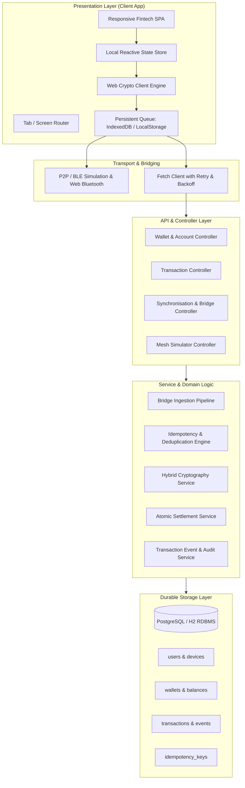

# MeshPay — Secure Offline Payment Experience
## Architecture and Technical Design Specification

### 1. Executive Summary & Problem Formulation
In high-growth digital economies like India, the Unified Payments Interface (UPI) handles billions of monthly transactions. However, standard UPI relies strictly on **synchronous, persistent 4G/5G internet connectivity** across all three participants: the sender, the receiver, and the core banking system (CBS).

When users enter **zero-connectivity physical environments** (e.g. underground metro basements, basement parking lots, remote rural weekly haats, disaster zones, or overcrowded stadium concerts where cellular towers experience denial-of-service), digital payments fail completely, forcing users back to physical cash.

**MeshPay** is an engineering research prototype of an **Offline-First Delay-Tolerant Payment Protocol (DTN)**. Modeled on **RBI / NPCI UPI Lite and National Common Mobility Card (NCMC) offline architectures**, MeshPay allows two offline mobile devices to exchange an authenticated, tamper-proof payment promise over Bluetooth Low Energy (BLE). The encrypted envelope hops through nearby carrier devices until an opportunistic bridge device reaches cellular connectivity and commits the transaction to the bank ledger.

```
+---------------------------------------------------------------------------------------------------+
|                                   MESHPAY HIGH-LEVEL ARCHITECTURE                                |
+---------------------------------------------------------------------------------------------------+

 [ Offline Sender Phone ]                  [ Offline Peer / Merchant ]               [ Bridge Node ]
+-------------------------+              +-----------------------------+         +--------------------+
| UI: Mobile Fintech Web  |              | UI: Merchant QR / Soundbox  |         | Background Worker  |
| - Keypad & Recipient    |              | - Scans / Pairs P2P         |         | - Holds Packets    |
| - Web Crypto: AES + RSA |   BLE / P2P  | - Verifies Packet Format    |  BLE    | - Detects Internet |
| - Local Queue (IndexedDB| ------------>| - Queues Packet in Local DB | ------->|   (Cellular / Wi-Fi|
+-------------------------+              +-----------------------------+         +---------+----------+
                                                                                           |
                                                                                HTTPS POST | /api/v1/sync
                                                                                           v
                                                                             +----------------------------+
                                                                             | CENTRAL MESHPAY BACKEND    |
                                                                             | (Spring Boot 3.3.5 / Java) |
                                                                             |----------------------------|
                                                                             | 1. SHA-256 Deduplication   |
                                                                             | 2. Idempotency Gate (Cache)|
                                                                             | 3. RSA-OAEP Decryption     |
                                                                             | 4. Freshness Replay Filter |
                                                                             | 5. @Transactional Ledger   |
                                                                             | 6. Optimistic Locking DB   |
                                                                             +--------------+-------------+
                                                                                            |
                                                                               PostgreSQL / H2 In-Memory
                                                                             +--------------v-------------+
                                                                             | - users, devices, wallets  |
                                                                             | - transactions & events    |
                                                                             | - idempotency_keys         |
                                                                             +----------------------------+
```

#### Academic Standards & Theoretical Precedents:
1. **RFC 5050 (Delay-Tolerant Networking Bundle Protocol Architecture)**: Endorsed by the IETF for opportunistic store-and-forward communication in intermittently connected networks.
2. **RFC 5116 (Authenticated Encryption with Associated Data - AEAD)**: Mandates AES-256-GCM to guarantee both confidentiality and cryptographic integrity with a 128-bit authentication tag.
3. **Apple 'Find My' Network Model**: Proven real-world precedent where hundreds of millions of stranger devices securely relay opaque, encrypted Bluetooth payloads without inspecting or altering content.
4. **Reserve Bank of India (RBI) Regulatory Framework on Offline Payments (2022-2023)**: Formalized offline wallet caps (₹2,000 max limit) and deferred settlement guidelines for contactless transit.


### 2. Repository Audit: Baseline vs. Upgraded System

| Component / Dimension | Existing Baseline (`perryvegehan`) | MeshPay Upgraded Architecture |
|---|---|---|
| **User Interface** | Basic single-page developer table (`dashboard.html`) | Premium, responsive Fintech Web App (Google Pay / PhonePe aesthetic), Dark/Light mode, Lucide icons, 8 dedicated flows (Onboarding, Home, Pay Nearby, Receive, Details, History, Sync, Profile). |
| **Client Payment Flow** | Server-side simulated endpoint (`/api/demo/send`) generates the packet | True client-side offline execution: Web Crypto API generates one-time AES-256 keys, encrypts payload, encrypts AES key with RSA public key, stores in persistent local queue (`IndexedDB`). |
| **Offline Wallet Logic** | Single balance per account; no concept of offline reservation | Structured wallet: Total Balance, Reserved Offline Allowance, Available Online Balance, Disputed/Reconciliation Balance. |
| **State Machine** | Only 2 states: `SETTLED`, `REJECTED` | 9-state distributed payment state machine: `CREATED`, `AUTHENTICATED`, `QUEUED_OFFLINE`, `RECEIVED_LOCALLY`, `PENDING_SETTLEMENT`, `SETTLED`, `REJECTED`, `FAILED`, `REQUIRES_RECONCILIATION`. |
| **Database Schema** | 2 tables (`accounts`, `transactions`) with raw decimal amounts | Relational schema (`users`, `devices`, `wallets`, `transactions`, `transaction_events`, `idempotency_keys`, `sync_attempts`), integer paise amounts + strict constraints, Flyway / PostgreSQL readiness. |
| **Security & Cryptography** | Server-side RSA-2048 + AES-256-GCM | Client + Server hybrid encryption, nonce replay protection, 24h freshness window, device credentials, PIN hash validation, tamper-evident GCM authentication tags. |
| **Idempotency & Replay** | In-memory `ConcurrentHashMap` with fixed TTL | Multi-tier idempotency: Fast in-memory cache + durable database unique constraint on `packet_hash` + event audit log. |
| **Synchronisation & Mesh** | In-memory `VirtualDevice` batch gossip loop | Persistent client queue with exponential backoff, retry limits, conflict handling, and interactive bridge simulation. |

---

### 3. Layered Architectural Decomposition



---

### 4. Core Distributed Systems Principles in MeshPay

1. **Store-Carry-and-Forward (DTN - RFC 4838):**
   Unlike standard TCP/IP requiring an active end-to-end circuit, Delay-Tolerant Networking treats transport as asynchronous. Packets are persisted to non-volatile local storage on whatever device holds them, physically carried across space, and opportunistically forwarded when another peer is detected.

2. **At-Least-Once Transport + Idempotent Processing = Exactly-Once Semantics:**
   In epidemic gossip routing, duplicate delivery is guaranteed: multiple peer bridges will upload copies of the same transaction packet to the backend. The backend computes the deterministic cryptographic hash `SHA-256(ciphertext)` before decryption and claims it atomically. Redundant deliveries are dropped without incurring decryption or ledger update overhead.

3. **Deferred Settlement vs. Real-Time Settlement:**
   Online UPI provides real-time irrevocable settlement in < 2 seconds through NPCI and Immediate Payment Service (IMPS). In MeshPay, an offline transfer is an **authenticated cryptographically signed promise (IOU)**. Settlement is deferred until internet ingress occurs. To prevent malicious over-spending offline, MeshPay introduces an **offline spending allowance** (similar to RBI UPI Lite guidelines).
