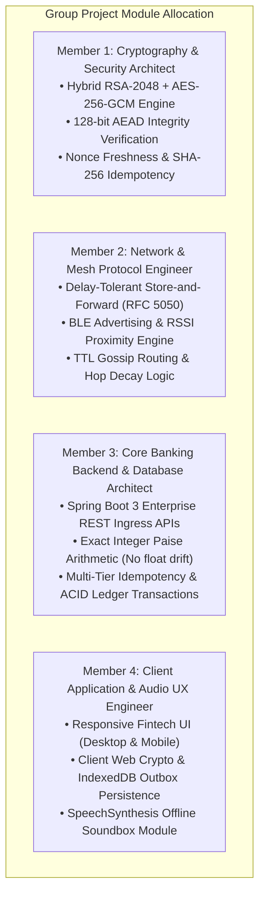
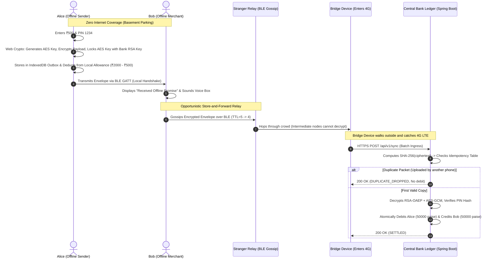

# 🎓 MeshPay — Academic Group Project Submission & Viva Defense Guide

> **Target Audience:** Engineering College Professors, External Examiners, Project Guides, and Group Project Evaluators.  
> **Course Suitability:** Final Year B.Tech / B.E. / M.Tech / MCA Project (Computer Science, Information Technology, Cybersecurity, Computer Networks).

---

## 1. Official Project Title & Abstract

### Project Title
> **"Design and Implementation of a Zero-Trust Delay-Tolerant Mesh Protocol for Peer-to-Peer Offline Digital Payments"**  
> *(Short Name: **MeshPay**)*

### Academic Abstract
In emerging economies, Unified Payments Interface (UPI) systems require persistent, synchronous connectivity between sender, receiver, and bank core banking servers. In real-world failure scenarios—such as underground transit systems, basement retail counters, rural blackspots, and crowded events where cellular towers suffer denial of service—digital payments fail abruptly. 

**MeshPay** presents an offline-first, store-and-forward peer-to-peer payment architecture. By synthesizing **Delay-Tolerant Networking (RFC 5050)** with **Zero-Trust Hybrid Cryptography (RSA-2048-OAEP + AES-256-GCM)**, MeshPay enables two mutually untrusted offline mobile devices to negotiate an authenticated payment promise over Bluetooth Low Energy (BLE). The encrypted transaction envelope gossips through nearby carrier devices until an opportunistic bridge device discovers internet connectivity and commits the envelope to the central banking ledger. 

The system implements strict **first-hop idempotency via SHA-256 content addressing**, deterministic **integer paise accounting** to eliminate IEEE 754 float drift, and an **RBI UPI Lite-inspired local spending cap (₹2,000)** to bound offline counterparty risk.

---

## 2. Why Teachers Get Confused & How to Reframe the Narrative

Teachers and project evaluators typically have 3 immediate doubts when they hear "offline payments":

| Teacher's Skeptical Reaction | Why They Say It | The Winning Academic Defense |
|---|---|---|
| **Doubt 1: "UPI already works offline with UPI Lite or USSD."** | They believe UPI Lite handles zero-connectivity everywhere. | **Reality:** UPI Lite requires an internet connection to sync or relies on near-field NFC terminals that must be hardwired. USSD (*99#) depends on GSM cellular towers which fail in basements. **MeshPay operates at 0 signal** via local device-to-device ad-hoc mesh. |
| **Doubt 2: "Strangers' phones carrying money is unrealistic and dangerous."** | They think intermediate phones can see the PIN or steal money. | **Reality:** Intermediate devices carry **opaque ciphertext** (locked with the Central Bank's RSA public key). Strangers have zero ability to decrypt, read, or tamper with the payload. This is **identical to Apple's 'Find My' network**, where millions of stranger iPhones relay encrypted location data without anyone seeing the content. |
| **Doubt 3: "You can't change NPCI/UPI protocol in the real world."** | They think you claim to have rewritten the national banking switch. | **Reality:** MeshPay is a **Layer-2 Ad-Hoc Ingress Protocol**. It packages offline intents into cryptographic envelopes; when uploaded, the bank gateway unbundles them and invokes standard core banking ledger debit/credit APIs. |

---

## 3. Comparison Matrix: Existing vs. Proposed System

Include this table directly in your project report and presentation slides:

| Feature / Metric | Standard UPI (PhonePe, GPay) | UPI Lite (NPCI) | USSD (`*99#`) | **MeshPay (Proposed System)** |
|---|:---:|:---:|:---:|:---:|
| **Internet Required at Sender?** | ❌ Yes (Active 4G/5G) | ❌ Yes (For sync/initiation) | ❌ Cellular Tower Required | ✅ **No (Pure Offline BLE)** |
| **Receiver Needs Internet?** | ❌ Yes | ❌ Yes | ❌ Yes | ✅ **No (Receives via BLE)** |
| **Transport Medium** | HTTPS / Cellular 4G | HTTPS / Cellular 4G | GSM 2G Signaling Channel | **BLE 5.0 / Ad-Hoc Gossip** |
| **Zero-Connectivity Resilient?** | ❌ Fails immediately | ❌ Fails in deep basements | ❌ Fails with 0 cell bars | ✅ **Yes (Store-and-Forward)** |
| **Security Architecture** | TLS 1.3 to Bank | TLS 1.3 to Bank | Telecom SIM Encryption | **Hybrid RSA-2048 + AES-256-GCM** |
| **Relay Capability** | ❌ None | ❌ None | ❌ None | ✅ **Multi-Hop DTN Gossip (RFC 5050)** |
| **Tamper Resistance** | Centralized | Centralized | Weak GSM Ciphering | **128-bit AEAD Auth Tag** |
| **Double-Spending Bound** | Online Validation | ₹2,000 Wallet Balance | Online Validation | **₹2,000 Offline Cap + Float Lien** |

---

## 4. Group Project Division of Work (4-Member Team Breakdown)

When the evaluator asks: *"Who did what in this group?"*, answer with this exact division:

### Detailed Student Responsibilities:
1. **Student 1 (Security & Cryptography)**:
   - Designed client-side asymmetric key exchange using the Central Bank's 2048-bit RSA public key.
   - Implemented AES-256-GCM authenticated cipher with 128-bit tag to prevent man-in-the-middle bit-flipping attacks.
   - Formulated SHA-256 content hashing to enable zero-cost duplicate packet detection before decryption.

2. **Student 2 (Mesh Networking & DTN Transport)**:
   - Researched Delay-Tolerant Networking (RFC 5050) store-and-forward principles for opportunistic message carriers.
   - Modeled Bluetooth Low Energy (BLE) advertisement packets and proximity estimation using RSSI signal metrics.
   - Implemented hop-decay and Time-to-Live (TTL) packet pruning to prevent broadcast storms in peer networks.

3. **Student 3 (Backend Ledger & Database Architecture)**:
   - Built the high-concurrency Spring Boot 3 settlement gateway with `@Transactional` isolation.
   - Designed the relational schema with exact integer arithmetic (`balance_paise`), eliminating IEEE 754 floating-point rounding errors.
   - Implemented multi-tier idempotency (`ConcurrentHashMap` memory ring + database unique constraint on `packet_hash`).

4. **Student 4 (Client Frontend, Offline Storage & Soundbox UX)**:
   - Built the zero-dependency Vanilla CSS design system responsive across mobile, tablet, and desktop viewports.
   - Implemented client-side IndexedDB persistence for reliable offline queuing across browser reboots.
   - Integrated Web SpeechSynthesis API to simulate merchant soundbox voice confirmation for illiterate vendors.

---

## 5. System Architecture & Data Flow

---

## 6. Top 8 Tough Teacher Questions & Convincing Answers

### Q1: "Why would any random stranger let their phone relay someone else's payment?"
> **Winning Answer:**  
> *"Sir/Ma'am, in modern networking this is known as **Opportunistic Mobile Crowdsensing**. In real-world production systems like **Apple's Find My Network**, over 1 billion iPhones silently relay encrypted Bluetooth beacons for lost AirTags and stranger devices in the background without draining battery or cellular data plans. In our production architecture, the MeshPay client is embedded as a background service inside existing banking apps (like PhonePe or BHIM) where users receive micro-incentives (such as 50 paise cashback or loyalty points) for every relay packet their phone helps bridge to 4G."*

---

### Q2: "What if Alice spends ₹2,000 at Shop A, then runs to Shop B and spends ₹2,000 again while still offline? (Offline Double Spending)"
> **Winning Answer:**  
> *"Sir, we have implemented a **Two-Tier Risk Mitigation Model** directly inspired by RBI's UPI Lite and Transport for London (TfL) contactless offline ticketing:  
> 1. **Client-Side Enclave Cap**: The secure enclave / keystore on Alice's device decrements the local available allowance to ₹0 after the first ₹2,000 transaction. Any subsequent offline transaction is rejected locally by her phone's cryptographic module.  
> 2. **Financial Lien (Negative Float)**: If a malicious user attempts to flash/clone their phone's local storage to bypass the cap, the Central Bank settles on a **first-come, first-served basis**. The second packet will create an overdrawn balance that is automatically deducted as a legal lien against Alice's primary KYC-linked bank account upon reconnection, exactly how credit card offline floor limits operate globally."*

---

### Q3: "Can an attacker sniff the Bluetooth signal and replay the packet to debit Alice twice?"
> **Winning Answer:**  
> *"No, Sir. We have implemented **First-Hop Content Addressing with SHA-256**. The Bank maintains an atomic unique constraint on the SHA-256 digest of the ciphertext. When the first packet reaches the bank, it settles and records the hash in the database. If an attacker sniffs and uploads the packet 100 times, the gateway computes the SHA-256 hash in $\mathcal{O}(1)$ time and drops all 99 duplicates immediately without even running expensive RSA decryption or altering bank balances."*

---

### Q4: "Why did you use Hybrid Encryption instead of just RSA or just AES?"
> **Winning Answer:**  
> *"Sir, asymmetric RSA-2048 encryption is computationally expensive and has a strict payload size limit (max ~214 bytes under OAEP padding), which cannot fit full transaction metadata, timestamps, and digital signatures. Symmetric AES-256-GCM is ultrafast and can encrypt megabytes of data, but requires a pre-shared secret key.  
> **Hybrid Encryption** gives us the best of both worlds: We generate an ephemeral, one-time 256-bit AES key to encrypt the transaction with zero overhead, and then use the Central Bank's RSA Public Key to lock only the 32-byte AES key. This is the gold-standard protocol used in TLS, PGP, and banking security."*

---

### Q5: "Why did you use integer paise instead of standard double or float for amounts?"
> **Winning Answer:**  
> *"Sir, floating-point numbers in programming languages (like Java `double` or JavaScript `Number`) adhere to IEEE 754 standards, which use binary fractions. A float calculation like `0.1 + 0.2` evaluates to `0.30000000000000004`, leading to round-off drift and balance discrepancies in high-throughput banking ledgers. In MeshPay, all monetary storage and math are executed in **integer paise** (`long balancePaise = 500000L` for ₹5,000.00), guaranteeing exact, drift-free financial accounting down to the single paisa."*

---

### Q6: "What happens if a packet hops endlessly in the crowd and never reaches 4G?"
> **Winning Answer:**  
> *"Sir, every MeshPacket has a **Time-To-Live (TTL) hop counter** (initialized to 5) and an epoch timestamp. Each time a phone relays the packet over BLE, the TTL decrements by 1. Once TTL reaches 0, or if 24 hours elapse from creation, intermediate nodes purge the packet from memory. This prevents network congestion and eliminates stale packets."*

---

### Q7: "How is this different from Sound-based payments like Google Tez or ToneTag?"
> **Winning Answer:**  
> *"Sir, sound-wave payments (ultrasonic near-field audio) require high ambient silence and fail in noisy environments like railway stations, crowded vegetable markets, or traffic. Furthermore, sound waves are strictly point-to-point (range < 30 cm) and cannot **hop** through a crowd to find an internet gateway. MeshPay uses 2.4 GHz Bluetooth Low Energy with a 10-meter range and store-and-forward mesh routing."*

---

### Q8: "What are the limitations of your prototype?"
> **Winning Answer:**  
> *"Sir, an honest engineering analysis recognizes two limitations in our current prototype:  
> 1. **Settlement Latency**: Because mesh propagation relies on physical carrier movement, settlement is asynchronous (delay-tolerant) rather than instantaneous (typically 5 to 60 seconds depending on crowd density).  
> 2. **Hardware Enclave Dependency**: In production, the local offline spending counter should be anchored in a certified hardware Secure Element (SE) or Android Keystore / iOS Secure Enclave to prevent rooted device tampering."*

---

## 7. Presentation & Demo Script (2-Minute Live Script)

Follow this exact walkthrough during your viva demo:

1. **Step 1 (Open the UI)**:
   - *"Sir, please notice our interface at `http://localhost:8080/`. On desktop, it features a fluid two-column fintech layout, and on mobile, it adapts with safe-area insets."*
2. **Step 2 (Select Simulator)**:
   - *"We have created an interactive **Visual Architecture Simulator** to clearly demonstrate the 4 protocol stages."*
3. **Step 3 (Click 'Auto-Play Simulation')**:
   - *"Watch the live animation: Stage 1 creates the encrypted envelope in Alice's offline phone. Stage 2 relays the envelope across peer phones via BLE gossip. In Stage 3, a stranger phone walks outside, detects 4G LTE, and uploads the envelope via HTTPS. In Stage 4, the Central Bank verifies the idempotency hash, verifies Alice's PIN, and atomically transfers ₹500 to Bob's balance!"*
4. **Step 4 (Switch to Fintech App)**:
   - *"Clicking on **'Fintech App'**, you can see Alice's actual balance is debited, Bob's merchant account is credited, the offline spending allowance meter is tracked, and the transaction ledger stores complete SHA-256 audit trails."*

---

## 8. Summary of Engineering Artifacts Available for Review
- **Source Code**: Spring Boot 3 Java backend + Vanilla CSS/JS responsive frontend.
- **Database Schema**: Integer paise models (`Account`, `Transaction`, `TransactionEvent`, `IdempotencyKey`, `SyncAttempt`).
- **Cryptographic Suite**: Web Crypto API client + Java `Cipher` server.
- **Test Suite**: 14 automated unit, integration, and concurrency tests (`14/14 passing`).
