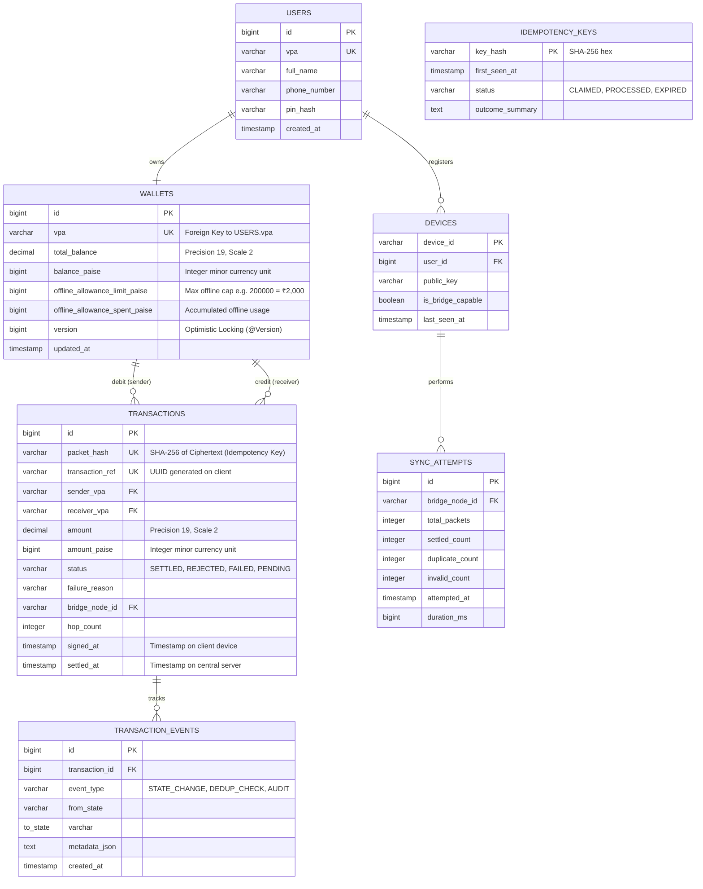

# MeshPay — Relational Database Design Specification

## 1. Entity Relationship (ER) Diagram



---

## 2. Monetary Precision & The "No Float" Rule

### Why Floating-Point Types (`FLOAT`, `DOUBLE`) Are Prohibited
In IEEE 754 floating-point arithmetic, binary fractions cannot precisely represent numbers like `0.1` or `0.01`:
```java
0.1 + 0.2 == 0.30000000000000004 // true!
```
In banking ledgers, cumulative rounding errors result in lost pennies and audit discrepancies.

### Dual-Layer Representation in MeshPay
1. **Integer Minor Currency Units (`balance_paise`, `amount_paise`):**
   - 1 Indian Rupee (INR) = 100 paise.
   - ₹500.00 is stored as `50000L` (bigint).
   - Arithmetic is strictly integer-based (addition/subtraction), eliminating all precision drift.
2. **Standard Decimal Display (`amount`, `balance`):**
   - Stored as `DECIMAL(19, 2)` for backward compatibility and formatted display.

---

## 3. ACID Properties in a Payment Settlement

| Property | Implementation in MeshPay | What Happens on Failure |
|---|---|---|
| **Atomicity** | Wrapped in `@Transactional(isolation = Isolation.READ_COMMITTED)`. Both sender debit and receiver credit occur together. | If credit throws an error, debit is rolled back automatically. The database remains unchanged. |
| **Consistency** | DB constraints: `CHECK (balance_paise >= 0)` and foreign keys guarantee that no phantom money is created and invalid states are rejected. | An overdraft or invalid VPA causes transaction rollback and triggers a `REJECTED` status record. |
| **Isolation** | Hibernate `@Version` optimistic locking + unique database constraints on `packet_hash`. | Concurrent attempts to debit the same account result in `OptimisticLockException` rather than lost updates. |
| **Durability** | Committed ledger writes and transaction event rows are persisted to disk WAL (Write-Ahead Logging) in PostgreSQL. | If the server power drops immediately after committing, the ledger remains completely intact on restart. |

---

## 4. PostgreSQL DDL Schema Script (`schema.sql`)

```sql
-- MeshPay Relational Schema (PostgreSQL & H2 Compatible)

CREATE TABLE IF NOT EXISTS users (
    id BIGSERIAL PRIMARY KEY,
    vpa VARCHAR(64) NOT NULL UNIQUE,
    full_name VARCHAR(128) NOT NULL,
    phone_number VARCHAR(20),
    pin_hash VARCHAR(64) NOT NULL,
    created_at TIMESTAMP WITH TIME ZONE DEFAULT CURRENT_TIMESTAMP
);

CREATE TABLE IF NOT EXISTS devices (
    device_id VARCHAR(64) PRIMARY KEY,
    user_vpa VARCHAR(64) REFERENCES users(vpa),
    public_key TEXT,
    is_bridge_capable BOOLEAN DEFAULT FALSE,
    last_seen_at TIMESTAMP WITH TIME ZONE DEFAULT CURRENT_TIMESTAMP
);

CREATE TABLE IF NOT EXISTS wallets (
    id BIGSERIAL PRIMARY KEY,
    vpa VARCHAR(64) NOT NULL UNIQUE REFERENCES users(vpa),
    total_balance DECIMAL(19, 2) NOT NULL DEFAULT 0.00,
    balance_paise BIGINT NOT NULL DEFAULT 0,
    offline_allowance_limit_paise BIGINT NOT NULL DEFAULT 200000, -- ₹2,000.00
    offline_allowance_spent_paise BIGINT NOT NULL DEFAULT 0,
    version BIGINT NOT NULL DEFAULT 0,
    updated_at TIMESTAMP WITH TIME ZONE DEFAULT CURRENT_TIMESTAMP,
    CONSTRAINT chk_positive_balance CHECK (balance_paise >= 0)
);

CREATE TABLE IF NOT EXISTS transactions (
    id BIGSERIAL PRIMARY KEY,
    packet_hash VARCHAR(64) NOT NULL UNIQUE,
    transaction_ref VARCHAR(64) UNIQUE,
    sender_vpa VARCHAR(64) NOT NULL,
    receiver_vpa VARCHAR(64) NOT NULL,
    amount DECIMAL(19, 2) NOT NULL,
    amount_paise BIGINT NOT NULL,
    status VARCHAR(32) NOT NULL,
    failure_reason VARCHAR(256),
    bridge_node_id VARCHAR(64) NOT NULL,
    hop_count INT NOT NULL DEFAULT 0,
    signed_at TIMESTAMP WITH TIME ZONE NOT NULL,
    settled_at TIMESTAMP WITH TIME ZONE NOT NULL,
    CONSTRAINT chk_positive_amount CHECK (amount_paise > 0)
);

CREATE INDEX IF NOT EXISTS idx_tx_packet_hash ON transactions(packet_hash);
CREATE INDEX IF NOT EXISTS idx_tx_sender ON transactions(sender_vpa);
CREATE INDEX IF NOT EXISTS idx_tx_receiver ON transactions(receiver_vpa);
CREATE INDEX IF NOT EXISTS idx_tx_settled_at ON transactions(settled_at DESC);

CREATE TABLE IF NOT EXISTS transaction_events (
    id BIGSERIAL PRIMARY KEY,
    transaction_id BIGINT REFERENCES transactions(id) ON DELETE CASCADE,
    event_type VARCHAR(64) NOT NULL,
    from_state VARCHAR(32),
    to_state VARCHAR(32),
    metadata_json TEXT,
    created_at TIMESTAMP WITH TIME ZONE DEFAULT CURRENT_TIMESTAMP
);

CREATE TABLE IF NOT EXISTS idempotency_keys (
    key_hash VARCHAR(64) PRIMARY KEY,
    first_seen_at TIMESTAMP WITH TIME ZONE NOT NULL,
    status VARCHAR(32) NOT NULL,
    outcome_summary TEXT
);

CREATE TABLE IF NOT EXISTS sync_attempts (
    id BIGSERIAL PRIMARY KEY,
    bridge_node_id VARCHAR(64) NOT NULL,
    total_packets INT NOT NULL,
    settled_count INT NOT NULL,
    duplicate_count INT NOT NULL,
    invalid_count INT NOT NULL,
    attempted_at TIMESTAMP WITH TIME ZONE DEFAULT CURRENT_TIMESTAMP,
    duration_ms BIGINT NOT NULL
);
```
