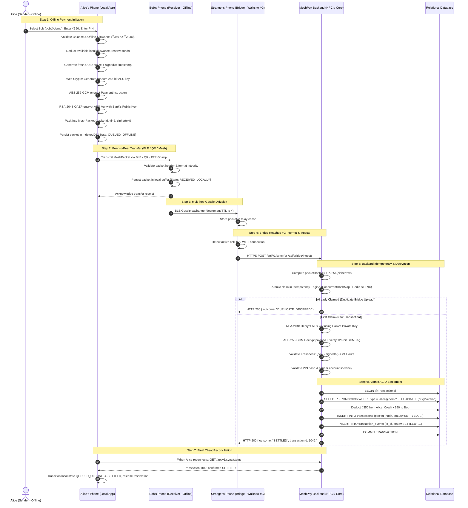
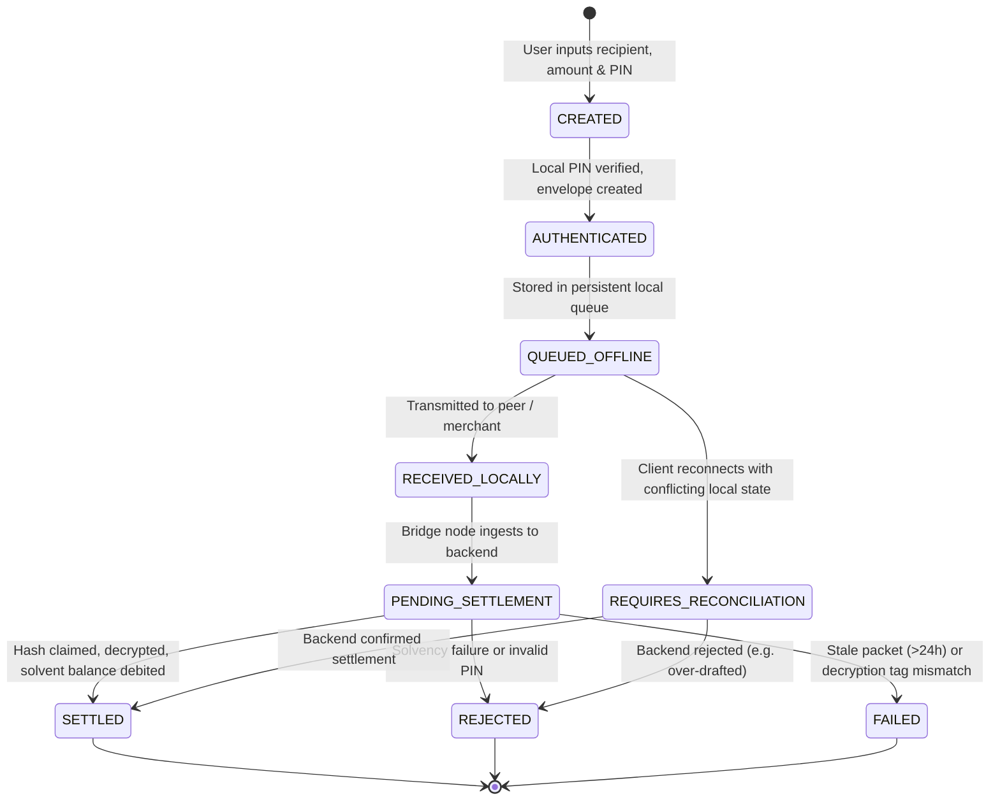

# MeshPay — Payment Flow and State Machine Specification

## 1. End-to-End Payment Sequence Diagram

---

## 2. Distributed Transaction State Machine

The transaction transitions through well-defined lifecycle states across the client, peer, and backend:

### State Definitions & Invariants

1. **`CREATED`**: Initial draft on sender's device. No cryptographic envelope yet.
2. **`AUTHENTICATED`**: User authorized transfer; AES-256-GCM + RSA-OAEP envelope created.
3. **`QUEUED_OFFLINE`**: Envelope stored in client's durable local store (IndexedDB). Sender wallet reserves funds from offline allowance.
4. **`RECEIVED_LOCALLY`**: Peer or merchant received the raw encrypted packet over BLE/QR. Displays local receipt with clear disclaimer: "Payment Promise Received (Pending Settlement)".
5. **`PENDING_SETTLEMENT`**: Ingested by backend, undergoing cryptographic validation and idempotency check.
6. **`SETTLED`**: Core ledger debited sender and credited receiver inside an atomic ACID transaction.
7. **`REJECTED`**: Sender account possessed insufficient total balance when packet was settled.
8. **`FAILED`**: Ciphertext was tampered with (AES-GCM tag mismatch), packet was stale (>24 hours), or malformed.
9. **`REQUIRES_RECONCILIATION`**: Client local record is pending or conflicting and requires synchronization with server.
