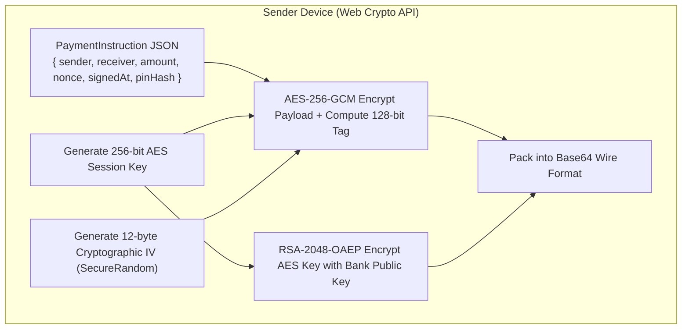

# MeshPay — Cybersecurity, Cryptography & Threat Model

## 1. Cryptographic Protocol Specification

MeshPay employs **Hybrid Authenticated Encryption (AEAD)** combining symmetric AES-256-GCM and asymmetric RSA-2048-OAEP:

```
[ 256 Bytes: RSA-2048-OAEP Encrypted AES Key ]
[ 12 Bytes:  AES-GCM Initialization Vector (IV) ]
[ N Bytes:   AES-256-GCM Ciphertext Payload ]
[ 16 Bytes:  Galois Authentication Tag (128-bit) ]
```



### Why Hybrid Encryption is Mandatory
1. **Asymmetric Limitation:** RSA-2048 with OAEP padding (SHA-256) has a maximum plaintext capacity of $\approx 190-214$ bytes:
   $$\text{Max Payload} = \text{KeySize} - 2 \times \text{HashLen} - 2 = 256 - 2(32) - 2 = 190 \text{ bytes}$$
   A structured JSON payment instruction with nonces and signatures exceeds 300 bytes.
2. **Symmetric Vulnerability:** If a shared symmetric AES key were embedded in client apps, reverse-engineering the APK would compromise all transactions system-wide.
3. **The Solution:** A one-time AES key is generated per transaction. Only the Central Bank holds the RSA Private Key capable of unwrapping the AES key.

---

## 2. Threat Model Matrix

| Threat / Attack Vector | Threat Agent | Vulnerability Exploited | MeshPay Mitigation Strategy | Residual Risk / Limitation |
|---|---|---|---|---|
| **Eavesdropping / Packet Sniffing** | Untrusted relay peer | Wireless BLE broadcast in crowd | Payload is encrypted with Central Bank's RSA Public Key. Intermediaries only see opaque ciphertext. | Traffic metadata (timing, hop count) remains observable. |
| **Tampering / Bit-Flipping** | Malicious bridge node | Altering amount or recipient in transit | AES-GCM 128-bit authentication tag. Any single-bit change causes decryption to throw `AEADBadTagException`. | Packet is dropped; delivery fails. |
| **Replay Attack** | Intermediary attacker | Capturing a valid packet and resubmitting days later | Multi-tier defense: (1) UUID nonce per payment, (2) 24-hour freshness window, (3) SHA-256 idempotency cache. | Replay within 24h is caught by hash deduplication; replay after 24h is rejected by timestamp. |
| **Duplicate Storm** | Concurrent bridge nodes | Multiple phones delivering the same packet at 4G ingress | SHA-256 of the ciphertext is checked atomically before decryption. Exactly one thread claims; all others receive `DUPLICATE_DROPPED`. | Memory consumption on backend managed via scheduled TTL eviction. |
| **Offline Double-Spending** | Malicious sender | Spending the same ₹500 to Bob in Basement A and Carol in Basement B | (1) Offline Spending Allowance Cap (₹2,000 max), (2) Central backend enforces first-come-first-served settlement; second transaction is recorded as `REJECTED (INSUFFICIENT_BALANCE)`. | Without internet or a hardware secure enclave (e.g. eSE / UICC in UPI Lite), pure software clients cannot prevent double-spending mathematically. |
| **PIN Interception** | Compromised relay | Inspecting network packets | PIN is hashed on client using SHA-256 and encapsulated within the AES-GCM ciphertext. Never transmitted in cleartext. | Client device compromise (keylogger) could capture PIN prior to encryption. |

---

## 3. Honest Architectural Limitations (For Evaluator & Viva Defense)

1. **IOU vs. Settled Currency:**
   When an offline sender's phone says "Payment Promise Exchanged", it is an authenticated promise, NOT settled bank funds. True settlement only occurs when the packet reaches the core bank ledger.
2. **Why Hardware Enclaves are Required in Production (UPI Lite):**
   Real offline systems (RBI UPI Lite / Apple Pay Cash) require a **Secure Enclave / Tamper-Resistant Hardware Chip** on the phone to store a pre-funded local balance counter that decrements monotonically in hardware. Pure software prototypes cannot stop an attacker who clones their phone's local storage.
3. **Encryption Does NOT Prove Solvency:**
   An attacker can create a validly encrypted, signed transaction instruction for ₹1,000,000 even if their account has ₹0. Solvency can only be verified when the backend decrypts and checks the ledger balance.
