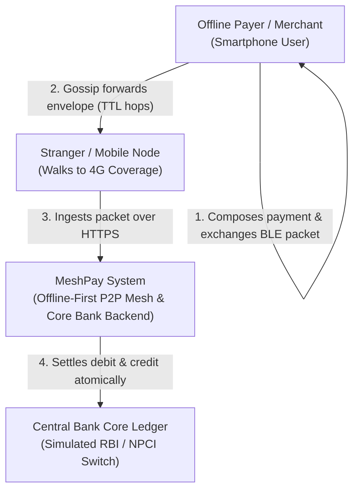
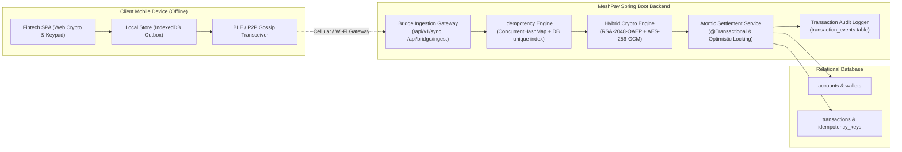

# MeshPay — System Design and Architectural Trade-Offs

## 1. System Context Diagram (C4 Level 1)

---

## 2. Component Decomposition (C4 Level 2)

---

## 3. Distributed Systems Concepts & Trade-offs in MeshPay

### 1. CAP Theorem & Network Partitions
- **Consistency (C):** Every read receives the most recent write or an error.
- **Availability (A):** Every non-failing node returns a response, without guaranteeing it contains the most recent write.
- **Partition Tolerance (P):** The system continues to operate despite an arbitrary number of messages being dropped or delayed by the network between nodes.
- **MeshPay's Decision:**
  During an offline period (network partition $P$), strict global real-time consistency is mathematically impossible without communication. MeshPay chooses **Eventual Consistency with an Offline Allowance Bound**:
  - The client trades strict global consistency for local availability ($A$), allowing users to spend up to ₹2,000.00 from their reserved offline allowance.
  - When the bridge node delivers the packet to the central backend, the system reconciles to strong consistency ($C$) through atomic ledger settlement.

### 2. Naive Retries vs. Idempotency & Exponential Backoff
- **The Problem:** In a gossip network, multiple peers forward copies of the same transaction simultaneously. If the backend treated every HTTP request as a new instruction, Alice would be debited multiple times for a single payment.
- **The Solution:**
  1. Deterministic hashing: `SHA-256(ciphertext)`.
  2. Multi-tier idempotency:
     - Tier 1: In-memory `ConcurrentHashMap.putIfAbsent(hash, timestamp)` (mimicking Redis `SET key NX EX 86400`).
     - Tier 2: Relational database unique constraint on `transactions.packet_hash` and `idempotency_keys.key_hash`.
  3. Client retry with truncated exponential backoff ($T = \min(T_{max}, T_{base} \times 2^{attempt}) \pm \text{jitter}$).

### 3. Monolith vs. Microservices
- **Decision:** MeshPay is implemented as a **Modular Monolith**.
- **Rationale:** Microservices introduce distributed transactions (2-Phase Commit / Sagas), network latency between services, and operational overhead that obscures core payment invariants. A clean modular monolith provides in-process transactional boundaries (`@Transactional`), compile-time type safety, zero network overhead between crypto and ledger, and trivial local testing via H2.
